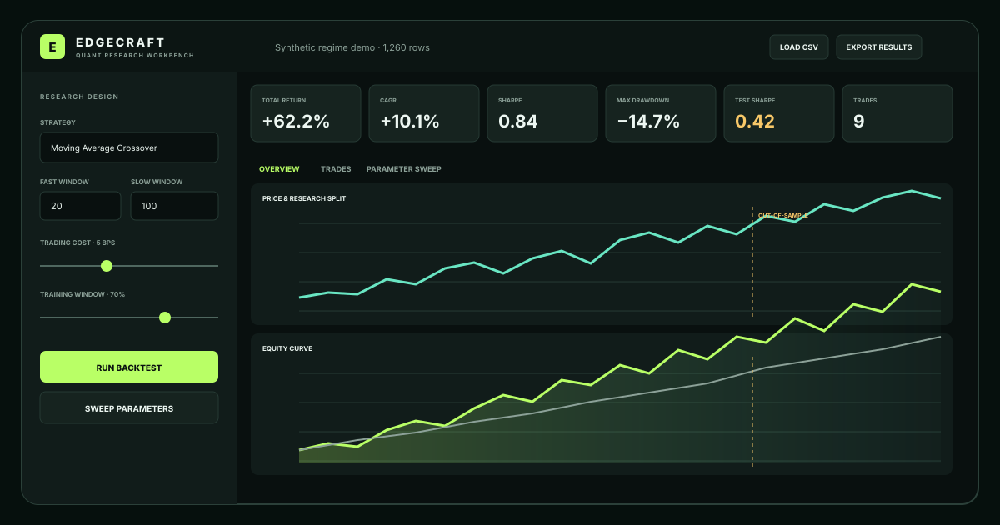

# Edgecraft Quant Research Workbench

**A native desktop application for testing trading ideas instead of admiring backtest screenshots.**

Edgecraft imports historical prices, creates transparent strategy signals, executes them one bar later, charges trading costs, separates training data from unseen test data, and shows whether an apparent edge survives out of sample.



## Why this version is different

The original Edgecraft was an educational browser calculator. The research workflow is now a real native desktop application built with Python and Tk. It opens in its own window, reads local CSV files, performs numerical research locally, and exports full backtest results. The original valuation and betting calculator remains in `index.html` as a lightweight project preview.

## Current research features

- Load a local CSV containing `Date` plus `Close`, `Adj Close`, or `Price`.
- Generate five years of deterministic demonstration data with changing market regimes.
- Test three long/flat strategies:
  - Moving-average crossover
  - RSI mean reversion
  - Price breakout
- Lag every signal by one bar to reduce look-ahead bias.
- Apply trading friction whenever exposure changes.
- Mark the train/test boundary directly on every chart.
- Compare strategy equity with buy-and-hold.
- Inspect drawdown and a complete trade ledger.
- Calculate total return, CAGR, volatility, Sharpe, Sortino, maximum drawdown, exposure, win rate, and out-of-sample performance.
- Sweep a compact parameter grid, rank candidates on training Sharpe, and display held-out test results separately.
- Double-click a sweep result to apply it to the active research run.
- Export every daily signal, position, cost, return, equity value, and segment to CSV.

## Start the desktop application on Windows

### Easiest method

1. Install [Python 3](https://www.python.org/downloads/) if it is not already installed. During installation, enable **Add Python to PATH**.
2. Double-click `start_edgecraft.bat`.
3. The first launch creates an isolated environment and installs pandas/numpy. Later launches open directly.

### Manual method

```powershell
py -3 -m venv .venv
.venv\Scripts\activate
python -m pip install -r requirements.txt
python edgecraft_app.py
```

## CSV format

At minimum, provide a date column and closing-price column:

```csv
Date,Open,High,Low,Close,Volume
2025-01-02,100.20,102.10,99.80,101.50,1250000
2025-01-03,101.40,103.00,100.90,102.60,1190000
```

Column matching is case-insensitive. Supported date names are `Date`, `Datetime`, `Timestamp`, and `Time`. Supported price names include `Adj Close`, `Adjusted Close`, `Close`, `Price`, and `Last`.

## Download a compiled Windows app from GitHub

The included GitHub Actions workflow tests the research engine and builds `Edgecraft.exe` automatically:

1. Push the project to GitHub.
2. Open the repository's **Actions** tab.
3. Select the latest successful **Test and build Windows app** run.
4. Download the `Edgecraft-Windows` artifact.
5. Extract and run `Edgecraft.exe`.

## Research methodology

For daily return `rₜ`, desired signal `sₜ`, position `pₜ`, and cost rate `c`:

```text
pₜ = sₜ₋₁
turnoverₜ = |pₜ − pₜ₋₁|
strategy returnₜ = pₜ × rₜ − turnoverₜ × c
```

The one-bar delay matters: a strategy cannot trade on a closing-price signal before that close exists. The train/test split is also visible rather than buried in a metric table. Parameter sweeps are ranked only on training performance; the test score stays out of selection and is shown afterward as a verification result.

## Tests

```powershell
python -m unittest discover -s tests -v
```

The test suite checks repeatable data generation, signal lagging, trading-cost effects, CSV normalization, and parameter-sweep ranking.

## What this still does not do

Edgecraft does not source market data, place trades, forecast returns with machine learning, model short selling, or account for taxes, slippage curves, liquidity, dividends, survivorship bias, or corporate actions. CSV quality and strategy assumptions remain your responsibility.

The next useful additions are multi-asset portfolios, benchmark/risk-free configuration, walk-forward parameter selection, Monte Carlo resampling, and notebook/report export.

## Disclaimer

This project is educational research software, not investment or gambling advice. Backtests can be wrong, overfit, or impossible to trade. Past performance does not predict future results.

## License

MIT — inspect it, fork it, test it, and improve it.
